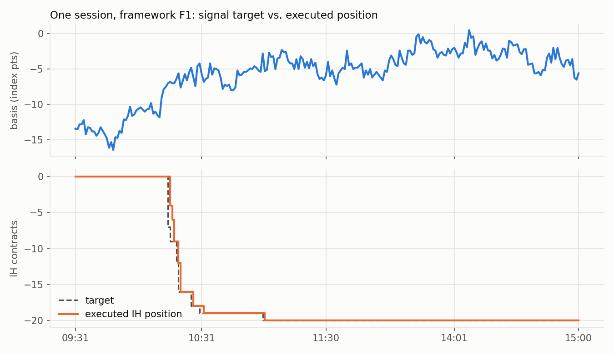
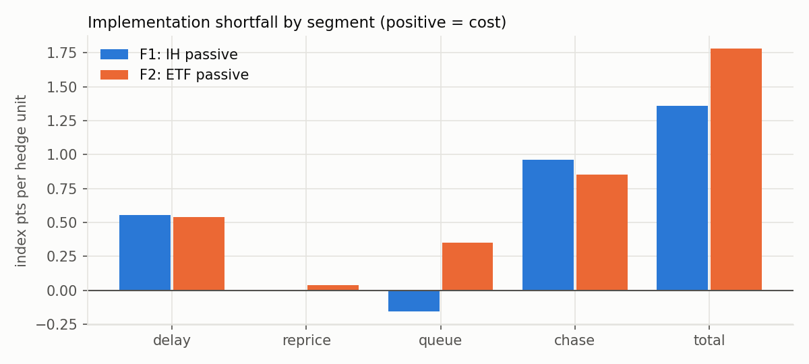

# IH–ETF Basis Backtester

A tick-level research stack for a cash-futures basis trade between the **SSE 50 index future (IH)** and the
**SSE 50 ETF (510050)**. It answers one question:

> Given a target position each minute, **can it be executed** on the real tick stream, how long does it take,
> and how much of the theoretical basis is lost to delay, queueing and crossing the spread?

Built from my work as a quantitative developer intern at a Chinese private fund (2026), then rewritten and made
public with synthetic data. **No proprietary data, credentials, strategy parameters or results are included.**

```
raw vendor ticks ─► clean ticks ─► 1-min bars ─► futures/spot panel ─► signal (target position)
                        │                                                  │
                        └─► per-tick order-book reconstruction ─► tick-replay execution engine
                                                                             │
                     hedge-unit attribution (5 anchors) ◄─ fills ─► FIFO round trips, P&L, reconciliation
```

## Highlights

**Data pipeline (`cleaning`, `bars`, `align`)**
- Normalizes two very different vendor feeds into one tick schema: Chinese-header futures snapshots with
  second-truncated timestamps (2 per second), and ETF snapshots with epoch-ms UTC timestamps, *cumulative* volume
  and 5-level depth stored as strings.
- Every rule that drops or edits data is counted in a **data-quality report**. Nothing is dropped silently.
- **Checked against the vendor's official 1-minute bars on 140 real trading days** (33,600 bars). Two convention
  fixes, OHLC from trades only and keeping the closing snapshot published 1–3 s late, raised agreement as follows:

  | field | prototype | this pipeline |
  |---|---|---|
  | IH open | 59.7 % | **99.99 %** |
  | IH high / low | 91.8 % | **99.2 %** |
  | ETF open | 91.9 % | **99.9 %** |
  | ETF volume (±1 lot) | 99.0 % | **99.5 %** |

  The remaining gaps are explained in [docs/data_quality_findings.md](docs/data_quality_findings.md).
- Bars sit on a canonical 240-minute grid with explicit zero-volume bars. A **stale-quote flag** covers both legs,
  and as-of joins carry a tolerance so a 13:00 tick is never priced against an 11:30 quote.

**Execution engine (`orderbook`, `execution`, `engine`)**
- Three layers: the market tape (read-only), the queue-state estimate, and an observation trace. The strategy's
  own orders can never feed back into market data.
- **Passive queue model**: an order joins behind the visible size at its price. Only trades that reach its price
  consume the queue. Cancellations shrink it, and price priority is kept across minutes.
- **Aggressive model**: crosses the spread, capped by L1 size and a participation rate.
- One engine, two mirror frameworks: `leader="IH"` (futures quoted passively, ETF hedged aggressively) and
  `leader="ETF"`.
- Trades come from *actual* holdings, never from the previous target, so partial fills carry over correctly. A
  fractional ETF position is rounded towards the target, never traded away and bought back.

**Attribution and post-trade checks (`attribution`, `performance`)**
- Every fill is tagged by the engine with the hedge unit it belongs to. Five price anchors per unit (signal, first
  quote, weighted quote, fill tick, execution) decompose implementation shortfall into **delay / reprice / queue /
  chase**, per leg.
- **Invariants asserted on every run**: segments sum exactly to signal-minus-execution basis; the passive leg
  fills exactly at its limit price; FIFO opened = closed + still open; hedge imbalance stays under one unit;
  daily *holding + trading* P&L equals cash + mark-to-market equity.

<p align="center"></p>
<p align="center"></p>

*Figures come from synthetic data and only illustrate the outputs. They are not results of any real strategy.*

## Quick start

```bash
pip install -e ".[dev]"
python scripts/make_synthetic_data.py        # 6 days of raw ticks in the vendor layouts -> data/raw/
python scripts/run_pipeline.py               # F1: IH passive / ETF aggressive  -> output/leader_IH/
python scripts/run_pipeline.py --skip-prepare --leader ETF      # F2 mirror     -> output/leader_ETF/
python scripts/make_figures.py
pytest                                       # 23 tests, incl. regression tests for every bug listed below
```

Main outputs: `data/interim/data_quality_report.csv`, `fills.csv`, `passive_order_events.csv`,
`hedge_unit_attribution.csv`, `round_trips_fifo.csv`, `minute_positions.csv`, `daily_pnl.csv`, `summary.json`.

To use your own data, put the raw IH files (`IH*.csv`) and `510050_SH_tick.csv` in `data/raw/`. Any signal works as
long as it yields an integer `target_ih_qty` (≤ 0) on every panel minute (`signals.validate_signal`).

## Bugs found and fixed in the original prototype

Each fix has a regression test.

| Issue | Effect | Fix |
|---|---|---|
| Bar OHLC taken from every snapshot's *last price* | bar open equals the previous close whenever a minute starts without a trade; 40 % of IH opens disagreed with the vendor | OHLC from trade snapshots only |
| ETF cumulative volume differenced *after* the session filter (one code path) | opening-auction volume attributed to the 09:31 bar | difference first, then filter |
| ETF tick VWAP = amount / *lots* instead of shares | VWAP 100× too high, so the reconstructed ask side was consumed by every trade | single `Instrument.vwap` with explicit units |
| Queue volume subtracted twice in the passive fill check | fills overstated | split tick volume into "ahead of me" and "left for me" |
| Passive order quoted at the raw mid | not a valid limit price when the spread is one tick | mid snapped to the passive side of the tick grid |
| Unstable `sort_index` on second-truncated timestamps | snapshots within the same second reordered | stable sort on (time, vendor sequence) |
| Fill times floored to the minute for position reports | every position shown one bar early ("data looks shifted by a minute") | same end-stamped bar convention as the market data |
| Closing snapshots stamped 11:30:01–03 / 15:00:01–03 dropped | 0.5 % of ETF bars short of volume | 5-second close grace, folded into the last bar |
| Raw futures files from overlapping monthly exports concatenated | duplicated trading days | each day taken from exactly one file |
| Corrupted depth values (e.g. `'2<'`) | mixed-type columns | coerced, dropped and counted |

## Repository layout

```
src/basis_bt/
  instruments.py   contract specs and the unit conventions (contracts / shares / board lots)
  sessions.py      trading calendar, end-stamped bar labels, trading-seconds clock
  cleaning.py      vendor ticks -> unified tick schema + data-quality report
  bars.py          1-minute bars on the 240-bar grid
  align.py         futures/spot minute panel, tick-level as-of join
  validation.py    comparison against vendor bars
  orderbook.py     per-tick book reconstruction (integer-tick prices)
  signals.py       signal contract + placeholder z-score signal
  execution.py     passive queue executor, aggressive executor
  engine.py        minute loop, leg planning, hedge-unit tagging
  attribution.py   5-anchor slippage decomposition, FIFO round trips
  performance.py   minute positions, daily P&L, reconciliation, metrics
  synthetic.py     synthetic raw data in the vendor formats
scripts/           CLI entry points
tests/             pytest suite
docs/              methodology and data-quality findings
```

See [docs/methodology.md](docs/methodology.md) for the execution model and its assumptions.

## Limitations

- Snapshot data cannot show trades *between* snapshots: queue position is an estimate, and intra-snapshot
  highs/lows are invisible (the remaining ~0.8 % IH high/low mismatch).
- The aggressive model takes a capped fraction of displayed size and ignores market impact.
- The signal is a placeholder used to exercise the engine. Its synthetic-data P&L means nothing.
